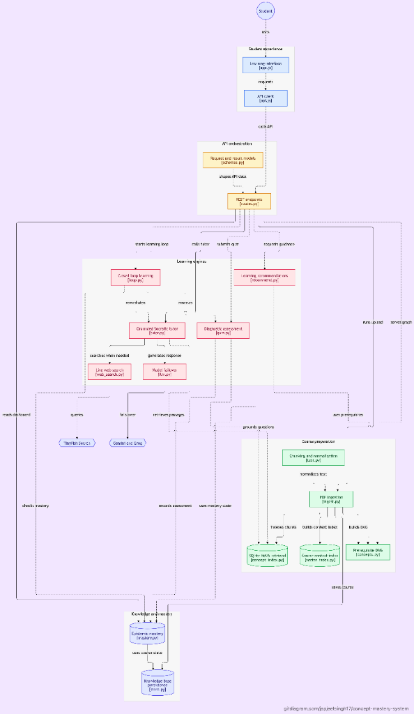

# Closed-Loop Concept Mastery Platform

A production-grade, closed-loop educational mastery platform that solves the fundamental limitations of baseline TutorLLM architectures:
1. **Vectorless RAG**: 100% dense-vector-free retrieval using section-based structural chunking, synonym normalization, and an inverted SQLite/BM25 index with exact page citations.
2. **Prerequisite Concept Graph (DAG)**: Automated concept extraction and dependency mining via NetworkX, cycle breaking by earliest appearance, and topological learning path generation.
3. **Explainable Epistemic Knowledge Tracing**: Tri-state mastery modeling (`UNKNOWN`, `WEAK`, `STRONG`) using Bayesian Beta belief distributions and uncertainty spreads, eliminating cold-start collapse and false single-check mastery.
4. **Two-Layer Socratic Guardrails**: Pedagogical scaffolding that prevents direct answer blurting while enforcing strict citation grounding (`[Page X]`).
5. **Closed-Loop LangGraph Engine**: Automated agentic cycle of Assessment &rarr; Diagnosis &rarr; Socratic Remediation &rarr; Re-assessment.
6. **Multi-Model LLM Resilience**: Primary integration with Google Gemini (`gemini-3.8-flash`) and instant automated failover to Groq Cloud (`llama-3.3-70b-versatile`).
7. **Multi-PDF Course Ingestion & Live Web Search**: Seamless batch ingestion of multiple PDFs into a unified prerequisite DAG, coupled with live web search powered by TinyFish Search API for broader queries, real-world examples, and conversational greetings.

---

## Architecture Overview



```
                      PROPOSED CLOSED-LOOP ARCHITECTURE
                      
  Student Study PDF
         │
         ▼
  ┌────────────────────────────────────────────────┐
  │  Section Chunker & Synonym Normalizer (rapidfuzz)│
  └───────────────┬────────────────────────┬───────┘
                  │                        │
                  ▼                        ▼
  ┌──────────────────────────────┐  ┌──────────────────────────────┐
  │ Vectorless Inverted Index   │  │ Prerequisite Concept Graph   │
  │ SQLite/BM25 with [Page X]   │  │ NetworkX DAG + Cycle Breaker │
  └───────────────┬──────────────┘  └──────────────┬───────────────┘
                  │                                │
                  └───────────────┬────────────────┘
                                  ▼
                    ┌───────────────────────────┐
                    │ Grounded Socratic Tutor   │
                    │ & Diagnostic Quiz Engine  │
                    └─────────────┬─────────────┘
                                  │
                                  ▼
                    ┌───────────────────────────┐
                    │ Epistemic Mastery Engine  │
                    │ (Beta Distribution &      │
                    │  Weak vs Unknown Detector)│
                    └─────────────┬─────────────┘
                                  │
                                  ▼
                    ┌───────────────────────────┐
                    │ Explainable Dashboard &   │
                    │ Targeted Re-Assessment    │
                    └───────────────────────────┘
```

---

## Repository Structure

```text
Concept-Mastery-System/
├── Aggressive Test Suite.py     # Comprehensive 40-test suite across 5 core categories
├── screenshots/                 # UI screenshots of the platform
│   ├── dashboard.png
│   ├── learning-path.png
│   ├── practice.png
│   ├── progress.png
│   ├── tutor.png
│   ├── upload.png
│   └── settings.png
├── frontend-designs/            # Figma/design reference specifications
└── concept-mastery/             # Full application stack
    ├── backend/                 # FastAPI backend application
    │   ├── app/
    │   │   ├── core/            # Text processing, normalizer, vectorless index
    │   │   │   ├── concept_index.py
    │   │   │   ├── text.py
    │   │   │   └── store.py
    │   │   ├── models/          # Pydantic v2 schemas
    │   │   │   └── schemas.py
    │   │   ├── pipelines/       # Closed-loop AI pipelines
    │   │   │   ├── concepts.py  # DAG prerequisite graph builder
    │   │   │   ├── ingest.py    # Vectorless PDF ingestion & chunking
    │   │   │   ├── loop.py      # LangGraph state machine & closed loop
    │   │   │   ├── mastery.py   # Epistemic knowledge tracing engine
    │   │   │   ├── quiz.py      # Diagnostic quiz generator & evaluator
    │   │   │   ├── recommend.py # Prerequisite-aware recommendation engine
    │   │   │   └── tutor.py     # Two-layer Socratic tutor
    │   │   ├── config.py        # Centralized configuration & provider settings
    │   │   ├── main.py          # FastAPI app entrypoint & static mount
    │   │   └── routes.py        # REST endpoints & API controllers
    │   ├── tests/               # Test suites (Pytest + DeepEval)
    │   │   ├── test_aggressive_suite.py  # 40-test system-level verification
    │   │   └── test_closed_loop.py       # End-to-end integration tests
    │   ├── requirements.txt     # Python backend dependencies
    │   ├── smoke_test.py        # Standalone verification runner
    │   └── synonyms.json        # Normalized domain ontology configuration
    ├── frontend/                # Vanilla JS SPA (No node_modules required)
    │   ├── css/                 # Modern styling & theme system
    │   │   └── styles.css
    │   ├── js/                  # SPA application controllers
    │   │   ├── api.js           # API client with auto-port detection
    │   │   ├── app.js           # Routing, DOM rendering & event loop
    │   │   └── mock.js          # Standalone offline mock data
    │   ├── vendor/              # Vendored KaTeX math rendering
    │   └── index.html           # Single-page application root
    └── data/                    # Persistent storage (SQLite DBs & uploads)
        ├── uploads/             # Ingested PDF textbooks & materials
        └── vectorstore/         # Inverted index & mastery SQLite DBs
```

---

## Key Features

### 1. Vectorless RAG
- Strictly avoids dense vector stores (Chroma, Pinecone, FAISS).
- Semantic section chunking preserving headers, paragraphs, and 1-indexed page boundaries.
- RapidFuzz synonym normalizer mapping student aliases (`"SGD"`, `"loss function"`) to canonical concepts.
- Inverted SQLite index + BM25 keyword matching for exact, deterministic chunk retrieval.

### 2. Prerequisite Concept Graph (DAG)
- Constructs a directed graph of dependencies between concepts.
- Cycle detection with automatic topological resolution based on earliest textbook occurrence.
- Provides prerequisite checks, learning paths, and next-concept recommendations.

### 3. Epistemic Knowledge Tracing
- Uses Bayesian $\text{Beta}(\alpha, \beta)$ belief distributions to calculate expected mastery $\mu = \frac{\alpha}{\alpha + \beta}$.
- Categorizes mastery into three distinct states:
  - **`UNKNOWN`**: Low evidence (attempts $< 2$ or high uncertainty spread $\sigma > 0.22$).
  - **`WEAK`**: High evidence of struggle ($\mu < 0.65$ after multiple attempts).
  - **`STRONG`**: Verified mastery ($\mu \ge 0.65$ with low uncertainty).
- Prerequisite Health Penalty: Discounts downstream mastery if parent concepts are unmastered.

### 4. Two-Layer Socratic Guardrails
- Scaffolding enforcement: Never blurts out answers or solutions.
- Grounded citations: Cites `[Page X]` and quotes source text verbatim.
- Anti-hallucination verification through retrieved passage constraints.

### 5. Closed-Loop LangGraph Engine
- Multi-step LangGraph state machine:
  1. `assess`: Evaluates student submission.
  2. `diagnose`: Pinpoints misconceptions.
  3. `remediate`: Generates targeted Socratic remediation.
  4. `reassess`: Loops back to diagnostic quiz until concept is mastered.

---

## Quick Start

### 1. Backend Setup
```bash
cd concept-mastery/backend

# Create and activate virtual environment
python3 -m venv .venv
source .venv/bin/activate       # On Windows: .venv\Scripts\activate

# Install dependencies
pip install -r requirements.txt

# Configure environment keys (optional, runs with fallback offline)
cp .env.example .env
# Edit .env with your GEMINI_API_KEY and/or GROQ_API_KEY

# Start FastAPI server
uvicorn app.main:app --port 8000 --reload
```

### 2. Access the Platform
- **Application UI**: Open [http://localhost:8000](http://localhost:8000)
- **API Swagger Docs**: [http://localhost:8000/docs](http://localhost:8000/docs)
- **Alternative Static Preview**: If serving the frontend from an IDE preview (e.g. port 5500), `api.js` automatically routes API traffic to `http://localhost:8000`.

---

## Running Tests

```bash
cd concept-mastery/backend
PYTHONPATH=. .venv/bin/pytest -v
```

### Test Suite Coverage (96/96 Passed — 100%)

The platform includes a 96-test automated test harness validating end-to-end correctness across 6 core architectural dimensions:

1. **Category 1 (TC-01 – TC-08)**: 100% Vectorless RAG & Dependency Audit (zero-vector guarantee, BM25 inverted index, exact 1-indexed citations, synonym normalization)
2. **Category 2 (TC-09 – TC-16)**: NetworkX Prerequisite DAG & Topological Progression (cycle breaking via earliest page appearance, self-loop pruning, graph serialization)
3. **Category 3 (TC-17 – TC-24)**: Epistemic AI Mastery Engine & Tri-State Classification (LLM-as-a-Judge semantic evaluation, lucky guess detection, prerequisite propagation, explainable audit trail)
4. **Category 4 (TC-25 – TC-32)**: Two-Layer Socratic Guardrails & Grounded Citations (prompt injection defense, answer key withholding, mandatory `[Page X]` verification)
5. **Category 5 (TC-33 – TC-40)**: Closed-Loop LangGraph State Machine & DeepEval (remedial routing, root-cause backtracking, circuit breakers, hallucination evaluation)
6. **Category 6 (TC-41 – TC-50)**: Quiz Session Boundaries, Skip Overflows & UI State (skip question clamping, progress bar bounds, idempotency, concurrent request stability)
7. **Integration Suite (6 Tests)**: Multi-page PDF ingestion, DeepEval context relevancy, Socratic citations, LangGraph closed-loop cycle, and Semantic AI-as-a-Judge validation.

---

## License
MIT License. Created as part of the Closed-Loop Concept Mastery Platform research project.

