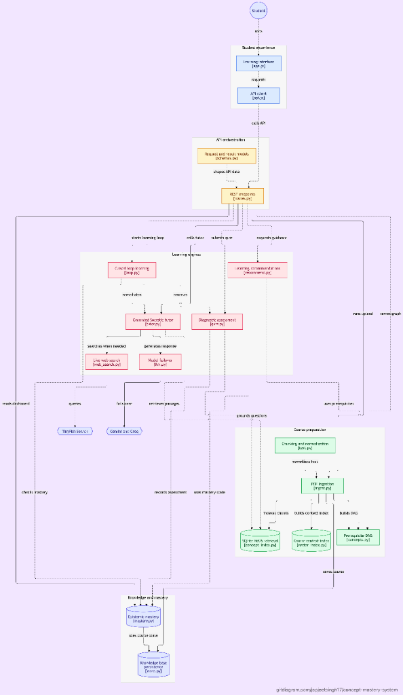

# Concept Mastery Platform



A closed-loop concept mastery learning system built around the epistemic architecture:
**Study PDF → Semantic section chunker & synonym normalizer → Vector index with page metadata + Prerequisite concept graph → Grounded tutor & quiz generator → Epistemic Beta belief mastery engine → Weak vs. Unknown detector → Targeted re-teaching & adaptive assessment → Explainable learner dashboard.**

---

## Quick Start

### 1. Backend Setup & Run
From the project root:

```bash
cd concept-mastery/backend

# Create virtual environment and activate
python3 -m venv .venv
source .venv/bin/activate       # macOS / Linux (Windows: .venv\Scripts\activate)

# Install dependencies
pip install -r requirements.txt

# Start FastAPI server
uvicorn app.main:app --reload --port 8000
```

Open **http://localhost:8000** in your browser. The backend serves the modern redesigned frontend directly from `frontend/`.

- **API Documentation**: http://localhost:8000/docs
- **Smoke Test**: `python smoke_test.py` (verifies offline ingestion, tutor RAG, quiz generation, and Bayesian mastery loop)

---

## Redesigned Frontend Experience

The frontend has been completely redesigned into a premium educational SaaS application matching the visual specification:

1. **Dashboard (`#dashboard`)**:
   - Welcome header and personalized student context (`Alex`).
   - Dynamic SVG Donut Chart displaying overall mastery belief score.
   - Live breakdown of **Strong** (Teal), **Weak** (Amber), and **Unknown** (Slate) concepts.
   - Proactive personalized next-step recommendation card with direct review action.
   - Interactive 5-stage **Learning Journey** workflow stepper (Upload Material &rarr; Learn Concepts &rarr; Take Quiz &rarr; Review Weak Topics &rarr; Master Concept).
   - Concept quick-glance progress indicators with direct quiz launching.

2. **Study Material Library (`#upload`)**:
   - Modern drag-and-drop file upload zone with `.pdf` validation.
   - Real-time 4-stage pipeline visualization (Semantic Chunker &rarr; Term Normalizer &rarr; Vector Indexer &rarr; Prerequisite Graph).
   - 1-click **"Try Sample: ML Basics"** button to instantly load the bundled textbook (`sample/ml-basics.pdf`).
   - Active knowledge base details (pages, chunks, discovered concepts).

3. **AI Tutor (`#tutor`)**:
   - Clean conversation layout distinguishing student messages from tutor responses.
   - Fully offline and CDN-fallback **KaTeX LaTeX math rendering** (formulas like $\frac{d}{dx}(x^2) = 2x$ rendered natively).
   - Grounded citations displaying page numbers and section headers.
   - Interactive **"View Source &rarr;"** modal displaying exact verbatim text passages from the textbook.
   - Dynamic follow-up suggestion chips ("Can you give me an example?", "What are the prerequisites?", "Why is this important?").

4. **Concept Check / Quiz (`#practice`)**:
   - Distraction-free question-by-question assessment.
   - Accessible choices A, B, C, D with keyboard shortcuts (`1-4` or `A-D`, `Enter` to submit).
   - **Authoritative Server-Side Grading**: The backend authoritatively grades answers and updates the epistemic Beta belief distribution.
   - Instant diagnostic explanation quoting specific textbook pages.
   - Side panel with live session accuracy donut gauge and pedagogical study tips.
   - Comprehensive quiz results screen with performance summary.

5. **Learning Path (`#learning-path`)**:
   - Connected vertical roadmap showing concepts in prerequisite topological order.
   - Status indicators: **Mastered** (Teal), **Needs Review** (Amber), and **Not Assessed** (Slate).
   - Interactive **Concept Mastery Radar / Spider Chart** comparing student belief scores against target (100%) mastery.
   - Collapsible SVG directed prerequisite graph showing topological dependencies with arrows.
   - Quick concept detail inspector dialog.

6. **Progress & Epistemic Analytics (`#progress`)**:
   - Deep-dive analytics into the epistemic Beta($\alpha$, $\beta$) learner model.
   - Diagnostic table showing concept names, status, mastery percentage, total attempts, uncertainty spread ($\pm X\%$), and diagnostic explanation.
   - Clear distinction between "Unknown" (insufficient evidence) vs "Weak" (verified struggle).

7. **Platform Settings (`#settings`)**:
   - Student profile name customization (persists in `localStorage`).
   - Seamless **Light Mode** and **Dark Mode** toggle.
   - Live backend health indicator and connection diagnostics.
   - Reset Mastery State button with confirmation.
   - Offline mock mode toggle for standalone demos.

---

## Architectural Mapping

| Architecture Stage | Backend File | Frontend Screen | Capability |
|---|---|---|---|
| Ingestion & Chunking | `pipelines/ingest.py` | Study Material (`#upload`) | Extracts text, chunks ~110 words, preserves page metadata |
| Terminology Normalization | `core/text.py` + `synonyms.json` | Study Material (`#upload`) | Resolves technical synonyms to canonical forms |
| Vector Index | `core/vector_index.py` | AI Tutor (`#tutor`) | TF-IDF vectors with cosine similarity search |
| Prerequisite Graph | `pipelines/concepts.py` | Learning Path (`#learning-path`) | Extracts concepts from headings/terms, establishes dependencies |
| Grounded Tutor | `pipelines/tutor.py` | AI Tutor (`#tutor`) | Context-restricted answers with page citations and text extracts |
| Adaptive Quiz Generator | `pipelines/quiz.py` | Concept Check (`#practice`) | Cloze/LLM questions grounded in document passages |
| Epistemic Mastery Engine | `pipelines/mastery.py` | Progress (`#progress`) | Beta($\alpha$, $\beta$) belief updates with uncertainty bounds |
| Closed Loop Controller | `pipelines/loop.py` | Entire App | answer &rarr; estimate &rarr; detect weak vs. unknown &rarr; recommend |

---

## Optional LLM Configuration

The platform runs 100% offline using deterministic extractive NLP and TF-IDF search. To enable optional LLM capabilities (Anthropic Claude or OpenAI):

Edit `backend/.env`:
```env
LLM_PROVIDER=anthropic   # or openai
LLM_API_KEY=your_key_here
LLM_MODEL=claude-3-5-sonnet-20241022  # or gpt-4o-mini
```
Tutor responses, quiz questions, and re-teaching lessons will automatically be synthesized by the model while remaining strictly grounded in the retrieved textbook passages.
