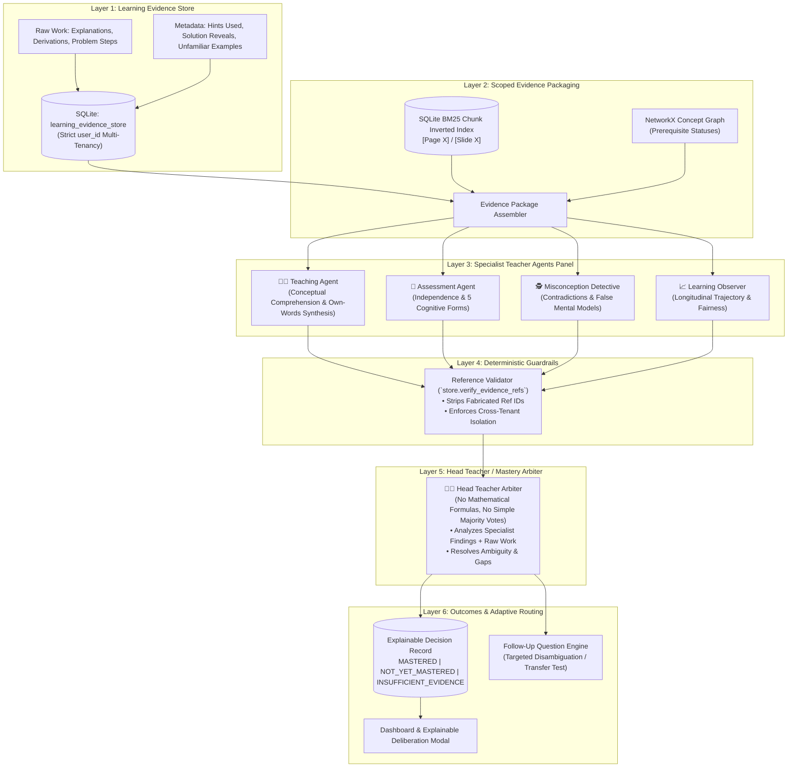

# Engineering & Pedagogical Report: 6-Layer Multi-Agent Pedagogical Assessment System

**Platform:** Closed-Loop Concept Mastery Platform  
**Architecture:** 6-Layer Multi-Agent Assessment Engine  
**Release Date:** November 2026  
**Status:** Verified in Production (232 / 232 Passing Tests)

---

## Executive Summary

Traditional Intelligent Tutoring Systems (ITS) and AI tutors quantify student knowledge through numerical estimators, such as Bayesian Knowledge Tracing (BKT) or Bayesian Beta distribution updates ($\text{Beta}(\alpha, \beta)$). While computationally straightforward, these mechanisms answer an impoverished question:

$$\text{"What numerical score did the student attain on multiple-choice options?"}$$

In practice, this approach produces significant educational failures:
1. **Lucky Guessing:** A student guessing two consecutive MCQs correctly is mathematically promoted to high confidence without genuine understanding.
2. **Hidden Misconceptions:** A student selecting the correct answer option while writing an explanation founded on a flawed mental model is scored positively, reinforcing false concepts.
3. **Hint Dependency:** Students heavily assisted by hints or solution reveals are grouped with independent problem solvers.
4. **Historical Penalties:** Early struggle permanently degrades numerical averages, failing to reward subsequent conceptual breakthroughs.

This report documents the architectural transition of the **Concept Mastery Platform** from the Bayesian Beta formula in `backend/app/pipelines/mastery.py` to a **6-Layer Multi-Agent Pedagogical Assessment System**. Five specialized LLM agents (4 Specialist Teacher Agents + 1 Head Teacher Arbiter), protected by deterministic software guardrails, evaluate authentic student work against curriculum materials to answer:

> **"Can we demonstrate, from the student's actual work, that they understand this concept and can apply it independently?"**

---

## System Architecture



---

## Detailed Layer Breakdown

### Layer 1: Learning Evidence Store
Unlike crude percentage counters, the platform persists student work in an append-only, multi-tenant SQLite table `learning_evidence_store`:
- `evidence_id`: Globally unique identifier (e.g., `evi_860957d4e1e0`).
- `user_id` & `concept_id`: Scoped indices ensuring complete tenant isolation.
- `question_form`: Categorized into `recall`, `explanation`, `application`, `transfer`, `prediction`, `quiz`, or `reassessment`.
- `student_answer` & `student_explanation`: Exact textual or numerical reasoning provided by the learner.
- `hints_used` & `solution_revealed_first`: Direct signals of scaffolding reliance.
- `is_unfamiliar_example`: Flags whether the student encountered this scenario during teaching.

### Layer 2: Scoped Evidence Packaging
The orchestrator builds an isolated `EvidencePackage` containing:
1. Grounded course material chunks retrieved via vectorless SQLite BM25 indexing with exact locator tags (`[Page 4]`, `[Slide 12]`).
2. Immediate parent prerequisite statuses from the topological DAG.
3. Chronological history of verified student evidence for this specific concept.

### Layer 3: The Four Specialist Teacher Agents
Each agent operates with a focused pedagogical mandate:

| Specialist Agent | Evaluation Question | Key Operational Rules |
| :--- | :--- | :--- |
| **👩‍🏫 Teaching Agent** | *Does the student demonstrate meaningful comprehension?* | • Compares student phrasing against textbook chunks.<br>• Distinguishes own-words synthesis from verbatim copying.<br>• Separates demonstrated knowledge from untested facets. |
| **🎯 Assessment Agent** | *Can the student apply understanding independently?* | • Evaluates performance across 5 cognitive forms (`recall`, `explanation`, `application`, `transfer`, `prediction`).<br>• Flags `hints_used > 0` or solution reveals as unproven independence. |
| **🕵️ Misconception Detective** | *Does the student hold a flawed mental model?* | • Detects answer-explanation contradictions.<br>• Uncovers confusion between adjacent topics.<br>• Prevents branding ambiguous wording as misconceptions without follow-up questions. |
| **📈 Learning Observer** | *Does learning history support persistent understanding?* | • Compares cross-session performance.<br>• **Rule A:** Single answer never yields `MASTERED` if foundations are untested.<br>• **Rule B:** Never penalizes past mistakes once overcome independently. |

### Layer 4: Deterministic Evidence Reference Verification
To prevent LLM hallucination in high-stakes grading, all agent assessments pass through `store.verify_evidence_refs`:
```python
def verify_evidence_refs(user_id: str, concept_id: str, claimed_refs: list[str]) -> list[str]:
    """Deterministically check SQLite database. Strip fabricated or cross-tenant IDs."""
```
Any `evidence_id` cited by an agent that cannot be proven to exist in the database for that authenticated `user_id` is immediately removed before the Head Teacher receives the assessment.

### Layer 5: Head Teacher / Mastery Arbiter
The Head Teacher reviews the 4 specialist findings and raw student submissions. It is explicitly prohibited from using numerical formulas, percentage thresholds, or simple majority voting (e.g., 3-to-1 splits). It resolves four core questions:
1. *What does the student demonstrably understand?*
2. *What important conceptual gaps remain?*
3. *Is the evidence sufficient to make a reliable determination?*
4. *What educational intervention should happen next?*

### Layer 6: Qualitative Decisions & Loop Routing
The Head Teacher produces an `explainable_mastery_decisions` record:
- **`MASTERED`** (Mapped to legacy `STRONG`): Conceptual explanation + independent application verified without active misconceptions.
- **`NOT_YET_MASTERED`** (Mapped to legacy `WEAK`): Active misconception, severe gap, or unassisted failure identified; accompanied by targeted remediation.
- **`INSUFFICIENT_EVIDENCE`** (Mapped to legacy `UNKNOWN`): 0 or 1 brief answer, or untested transfer; accompanied by an targeted follow-up question.

---

## Pedagogical Edge Cases & Behavior

### Case 1: Right Answer, Wrong Mental Model
**Scenario**: Student selects the correct option on a Learning Rate quiz, but writes:
> *"A very large learning rate is best because it guarantees faster convergence to the minimum."*

- **Bayesian Beta Behavior**: The numerical engine scores the response as `Correct (+1)`, incrementing $\alpha$ and raising mastery toward 75%.
- **Multi-Agent Assessment Behavior**:
  1. **Misconception Detective**: Identifies contradiction between selection and explanation, flagging learning rate divergence.
  2. **Head Teacher**: Withholds `MASTERED` and returns `NOT_YET_MASTERED`. Prescribes remediation targeting divergence oscillations.

### Case 2: Thin Evidence Gating
**Scenario**: New student gives a single correct definition for *"Gradient Descent"*:
> *"Gradient descent iteratively steps in the direction of steepest descent to minimize loss."*

- **Bayesian Beta Behavior**: Assigned an arbitrary prior or single-observation mean (~50%), treating the student as partially trained.
- **Multi-Agent Assessment Behavior**:
  1. **Teaching Agent**: Confirms high-level purpose is understood; notes role of step size and calculation remains untested.
  2. **Assessment Agent**: Flags that application and prediction forms are untested.
  3. **Head Teacher**: Returns `INSUFFICIENT_EVIDENCE` (neutral `NEEDS EVIDENCE` badge). Generates a follow-up prediction problem: *"What occurs if the gradient reaches exactly zero?"*

### Case 3: Overcoming an Early Misconception
**Scenario**: Student struggled with Backpropagation on Day 1, failing two consecutive attempts. On Day 2, after reviewing study notes, the student independently derives parameter updates with zero hints.

- **Bayesian Beta Behavior**: The failure records ($\beta = 2$) drag down the mean score:
  $$\text{Mastery} = \frac{1 + 1}{2 + 1 + 2} = 40\% \quad (\text{Branded WEAK})$$
- **Multi-Agent Assessment Behavior**:
  1. **Learning Observer**: Identifies that previous misconceptions were resolved in subsequent unassisted work.
  2. **Head Teacher**: Enforces fairness principle (Rule B) and awards `MASTERED` without historical penalties.

---

## Deterministic Guardrails & Workflow Limits

To ensure system stability and predictable execution times:

```text
┌─────────────────────────────────┬───────────┬────────────────────────────────────────────────────────┐
│ Constraint                      │ Value     │ Purpose                                                │
├─────────────────────────────────┼───────────┼────────────────────────────────────────────────────────┤
│ MAX_FOLLOW_UP_QUESTIONS         │ 2         │ Caps consecutive disambiguation questions per cycle.   │
│ MAX_AGENT_CALLS                 │ 6         │ Prevents runaway LLM orchestration costs.              │
│ AGENT_TIMEOUT_SECONDS           │ 20s       │ Enforces bounded latency per agent execution.          │
│ Offline Fallback Mode           │ Active    │ Rule-based heuristics maintain grading during outages. │
│ evaluation_pending Flag         │ Boolean   │ Prevents loss of student work during API failures.     │
└─────────────────────────────────┴───────────┴────────────────────────────────────────────────────────┘
```

---

## Verification & Test Battery Summary

The complete test suite verifies multi-tenancy, deterministic reference checks, cognitive forms, and backward compatibility.

```text
==================================== 232 / 232 PASSED (100%) ====================================
```

| Test Suite Module | Tests | Focus Area | Status |
| :--- | :---: | :--- | :---: |
| `tests/test_multi_agent_mastery.py` | 17 | Multi-Agent Arbiter, Cognitive Forms & Guardrails | **PASSED** |
| `tests/test_baseline_diagnostic.py` | 3 | Zero-State Gating & First-Run Diagnostic | **PASSED** |
| `tests/test_numerical_and_active_recall.py` | 14 | Quantitative Problems & 4-Stage Active Recall | **PASSED** |
| `tests/test_oauth_multi_tenancy.py` | 7 | Google OAuth & Tenant Evidence Isolation | **PASSED** |
| `tests/test_closed_loop.py` | 7 | LangGraph Socratic Loop & DeepEval Tracing | **PASSED** |
| `tests/test_universal_material_ingest.py` | 8 | Vectorless BM25 Multi-Format Ingestion | **PASSED** |
| `tests/test_openrouter_gateway.py` | 6 | OpenRouter Gateway & Response Sanitization | **PASSED** |
| `tests/test_tools_tts_and_notes.py` | 20 | ElevenLabs Flash v2.5 Audio, PDF & PPTX Deck | **PASSED** |
| `tests/openrouter_testcases.py` | 50 | OpenRouter Gateway Failover Robustness | **PASSED** |
| `final_100_test_cases.py` | 100 | System-Wide End-to-End Regression Battery | **PASSED** |
| **Total Test Suite** | **232** | **Full System Verification** | **100% Passed** |

---

## Conclusion

The 6-Layer Multi-Agent Pedagogical Assessment System transforms the Concept Mastery Platform from a superficial answer-checking application into a principled educational engine. By shifting focus to demonstrated independent understanding and explainable deliberation, students receive targeted, actionable learning guidance grounded in their actual coursework.

